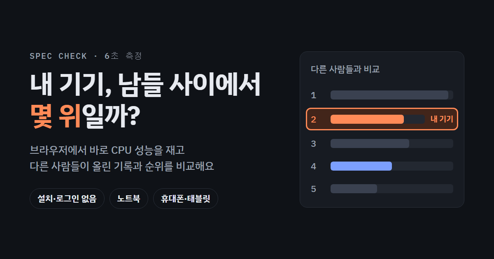
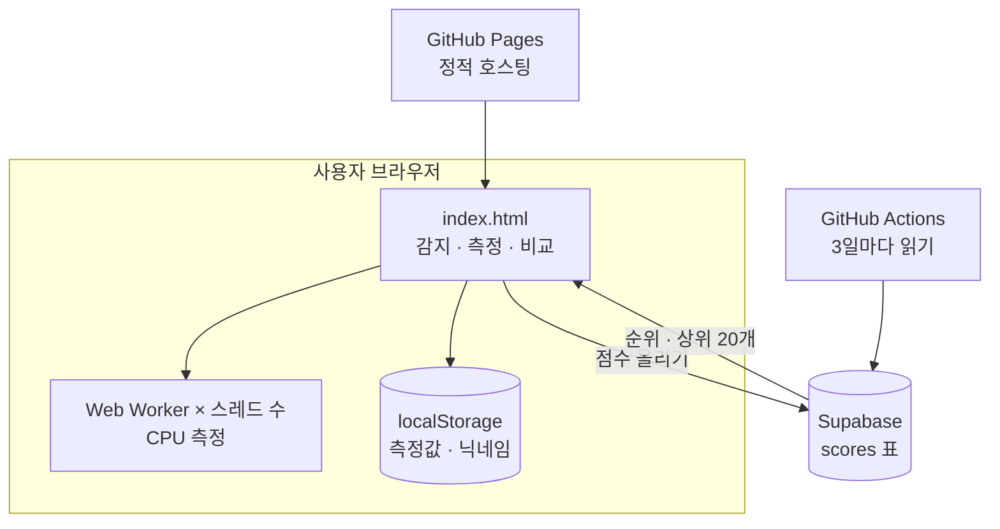

<div align="center">

<a href="https://jeiel85.github.io/laptop-spec-compare/"></a>

# 내 기기 측정하고 다른 사람들과 순위 비교

**브라우저에서 6초 만에 노트북·휴대폰·태블릿의 CPU 성능을 재고,<br>다른 사람들이 올린 기록 사이에서 몇 위인지 보여주는 웹 페이지예요.**

[](https://jeiel85.github.io/laptop-spec-compare/)

[](https://jeiel85.github.io/laptop-spec-compare/)
[](https://supabase.com)
[](spec-compare.html)
[](https://github.com/jeiel85/laptop-spec-compare/actions/workflows/supabase-keepalive.yml)

</div>

---

## ✨ 이런 걸 해요

| 기능 | 설명 |
|---|---|
| ⚡ **6초 자동 측정** | 페이지를 열면 기기를 확인하고 CPU 싱글코어·멀티코어 성능을 바로 재요. 설치도 로그인도 없어요. |
| 🏆 **다른 사람들과 순위** | 점수를 올리면 "N대 중 M위(상위 X%)"와 상위 20개 목록을 보여줘요. 노트북 / 휴대폰·태블릿 순위를 따로 볼 수 있어요. |
| 🎲 **자동 닉네임** | "말랑한 수달", "반짝이는 사막여우"처럼 닉네임을 알아서 지어줘요. 다시 뽑거나 직접 바꿔도 돼요. |
| 🎮 **할 수 있는 일 판단** | 웹·문서, 개발, Docker, 사진·영상 편집, 게임 3단계, 로컬 AI, 이미지 생성 AI가 쾌적한지 / 제한적인지 / 어려운지 알려줘요. |
| 📊 **항목별 비교** | CPU, 그래픽, 메모리, 화면, NPU를 기준 노트북과 막대그래프로 비교해요. |
| 🔒 **원할 때만 공유** | 측정 결과는 브라우저에만 저장돼요. "점수 올리기"를 누를 때만 점수판에 보내요. |

## 📏 점수는 어떻게 매기나요

- **기준 노트북 = 1,000점**: Intel Core 5 210H(8코어 12스레드), 32GB 노트북에서 잰 값을 1,000점으로 놓고 비교해요.
- **싱글코어**: 계산 작업 하나를 Web Worker 하나로 돌려요. 2번 재서 높은 값을 써요.
- **멀티코어**: 같은 작업을 스레드 수만큼 Web Worker로 동시에 돌려요.
- **그래픽**: 감지하거나 고른 그래픽을 3DMark Time Spy 그래픽 점수로 알려진 값에 대응시킨 **추정치**예요. 직접 재지는 않아요.
- 탭이 화면에 보일 때만 재요. 가려진 탭은 브라우저가 속도를 8~12배 낮추거든요.

> [!TIP]
> **정확하게 재려면** 충전기를 꽂고, 다른 프로그램을 닫고, Chrome이나 Edge에서 여세요. 측정하는 동안 탭을 바꾸지 마세요.

## 🔍 브라우저가 알려주는 것과 아닌 것

| 자동으로 알아내요 | 직접 골라야 해요 |
|---|---|
| 기기 종류(노트북·휴대폰·태블릿), 운영체제 | CPU(칩) 모델명 |
| CPU 스레드 수 | 메모리 용량 |
| 브라우저가 쓰는 그래픽, 화면 해상도·주사율 | **외장 그래픽** (하이브리드 노트북) |

> [!NOTE]
> 외장 그래픽(RTX 등)과 내장 그래픽이 함께 있는 노트북은 브라우저가 **내장 그래픽만** 보여줄 때가 많아요(Lenovo LOQ에서 Edge·Chrome 모두 확인). 그래서 외장 그래픽을 못 찾으면 "없다"고 단정하지 않고, 직접 골라 달라고 안내해요.
>
> Windows 노트북은 페이지 아래의 PowerShell 명령어를 실행해서 결과를 붙여넣으면 CPU·메모리·그래픽이 정확하게 채워져요. 사양을 읽기만 하고 아무것도 바꾸지 않아요.

## 🔐 점수판과 개인정보

"점수 올리기"를 누를 때만 아래 정보를 보내요.

```
닉네임 · 기기 종류 · 운영체제 · CPU·그래픽 이름 · 스레드 수 · 메모리 · 점수 · 브라우저 이름
```

- 이름과 위치는 보내지 않고, 로그인도 없어요. 점수와 함께 IP를 저장하지 않지만, Supabase 접속 기록에는 남을 수 있어요.
- 기기는 브라우저에서 만든 임의 ID로 구분하고, 목록에는 그 ID의 해시만 보여요.
- 같은 기기는 **마지막으로 올린 점수 하나만** 순위에 쓰여요. 한 기기에서 1시간에 5번까지 올릴 수 있어요.
- 점수판 표는 익명 사용자가 **추가만** 할 수 있어요. 읽기, 수정, 삭제는 막혀 있고, 범위를 벗어난 점수는 DB가 거부해요.

## 🏗️ 구조

빌드 도구 없이 HTML 파일 하나로 동작해요. 서버는 Supabase의 REST API만 써요.



| 파일 | 내용 |
|---|---|
| [`spec-compare.html`](spec-compare.html) | 페이지 원본. **수정은 여기서** 해요 |
| [`build.ps1`](build.ps1) | 원본으로 `index.html`을 만들어요 (로컬에선 프로젝트 zip도 만들어요) |
| `index.html`, `.nojekyll` | 빌드 결과. GitHub Pages가 보여주는 페이지예요. 직접 고치지 않아요 |
| [`supabase/migrations/`](supabase/migrations) | 점수판 DB에 적용한 SQL (표, 권한, 뷰, 함수, 횟수 제한, 기준 행) |
| [`.github/workflows/supabase-keepalive.yml`](.github/workflows/supabase-keepalive.yml) | 무료 Supabase 프로젝트가 일시정지되지 않게 3일마다 DB를 깨워요 |
| `og-image.png`, [`assets/og-card.html`](assets/og-card.html) | 링크 미리보기 이미지(1200×630)와 그 원본 |
| [`docs/leaderboard-design.md`](docs/leaderboard-design.md) | 점수판 설계서 |

## 🛠️ 개발

```powershell
# 1. spec-compare.html 을 고쳐요
# 2. index.html 을 다시 만들어요
powershell -ExecutionPolicy Bypass -File .\build.ps1
# 3. 커밋하고 main에 올리면 GitHub Pages가 1~2분 뒤 반영해요
```

<details>
<summary><b>미리보기 이미지 다시 만들기</b></summary>

`assets/og-card.html`을 고친 뒤 이 폴더에서 실행해요 (Edge 헤드리스로 1200×630 캡처).

```powershell
& 'C:\Program Files (x86)\Microsoft\Edge\Application\msedge.exe' --headless=new --disable-gpu --hide-scrollbars --force-device-scale-factor=1 --window-size=1200,630 --virtual-time-budget=8000 --screenshot="$PWD\og-image.png" "file:///$($PWD -replace '\\','/')/assets/og-card.html"
```

</details>

<details>
<summary><b>점수판(Supabase) 운영</b></summary>

- 프로젝트: `laptop-spec-compare` (ref `ijemtaegzsecsqqcgeza`, 서울 리전, Free 플랜)
- 페이지의 `LEADERBOARD`에는 **공개용 키(`sb_publishable_...`)만** 넣어요. `service_role`·`sb_secret_...` 키는 절대 넣지 않아요.
- 이상한 점수 지우기: Supabase 대시보드 → Table Editor → `scores` → 행 선택 → Delete
- 일주일 넘게 활동이 없으면 프로젝트가 일시정지돼요. keep-alive 워크플로가 이걸 막아요.
  - 공개 저장소에 60일 동안 커밋이 없으면 GitHub가 예약 실행을 꺼요. 메일이 오면 **Actions → Supabase keep-alive → Enable workflow**를 눌러요.
  - 이미 일시정지됐으면 대시보드에서 **Restore**를 눌러요. 일시정지된 채로 90일이 넘으면 대시보드에서 바로 복구할 수 없어요.
- 측정 코드(`WORKER_SRC`)나 측정 순서를 바꾸면 `BENCH_VERSION`을 올리고, DB 정책과 `score_stats`의 `bench_version` 조건도 새 마이그레이션으로 같이 바꿔요.

</details>

<details>
<summary><b>기준값 다시 재기</b></summary>

`spec-compare.html`의 `A.bench`에 기준 노트북에서 잰 CPU 원점수가 들어 있어요 (2026-10-23, Chromium, 3회 중앙값). 다시 재려면 기준 노트북에서 페이지를 열고, 측정이 끝난 뒤 브라우저 콘솔에서 `__lastBench`를 확인해 그 값으로 바꿔요. 이미 올라간 점수(`*_pts`)는 DB에 같이 저장된 원점수(`*_raw`)로 다시 계산해요.

</details>

<details>
<summary><b>내 GitHub Pages로 배포하기 (포크)</b></summary>

1. 이 저장소를 포크해요.
2. **Settings → Pages**에서 Source를 **Deploy from a branch**, Branch를 **main / (root)**로 고르고 Save를 눌러요.
3. 점수판을 따로 쓰려면 Supabase 프로젝트를 만들고 `supabase/migrations/`의 SQL을 순서대로 실행한 뒤, `spec-compare.html`의 `LEADERBOARD`에 내 URL과 공개용 키를 넣고 다시 빌드해요. 비워 두면 점수판 섹션이 숨겨져요.
4. keep-alive를 쓰려면 **Settings → Secrets and variables → Actions**에 `SUPABASE_URL`, `SUPABASE_KEY`(공개용 키)를 넣어요.

</details>

## ⚠️ 알려진 한계

- **iPhone·iPad**: Safari는 브라우저 엔진이 달라서 CPU 점수가 20% 정도 다르게 나올 수 있어요.
- **Firefox**: 그래픽 이름을 감춰서 그래픽 비교가 어려워요.
- **측정 조건**: 배터리 모드, 저전력 모드, 발열, 백그라운드 작업이 있으면 점수가 낮게 나와요. 다른 측정과 동시에 돌리면 절반 가까이 떨어져요.
- **장난 점수**: 공개 키로 누구나 올릴 수 있어서 범위 검사와 횟수 제한까지만 막아요. 나머지는 대시보드에서 지워요.

개선 후보는 [Hardening candidates](https://github.com/jeiel85/laptop-spec-compare/issues/1) 이슈에 모아 두었어요.
